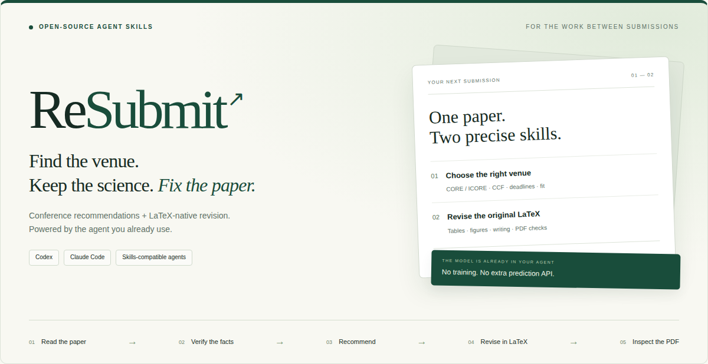

<p align="center">
  
</p>

<p align="center"><strong>From your current manuscript to its next submission — with the agent you already use.</strong></p>

<p align="center">
  <a href="#workflow-in-motion">Workflow</a> ·
  <a href="#how-resubmit-compares">Comparison</a> ·
  <a href="#quick-start">Quick start</a> ·
  <a href="docs/INSTALL.md">Installation</a> ·
  <a href="CONTRIBUTING.md">Contribute</a>
</p>

**ReSubmit** is an MIT-licensed pair of Agent Skills for **paper-aware conference recommendations** and **native LaTeX revision**. Your existing agent can inspect a paper and author-visible reviews, reason with the appropriate scientific community, verify the actual venue opportunity, recommend a primary and backups, and help revise the paper and inspect its PDF.

**No model training · No separate prediction API · No manuscript-upload website.** The host provides its own model, browsing, tools and applicable costs/policies.

## Workflow in motion

<picture>
  <source media="(prefers-reduced-motion: reduce)" srcset="docs/assets/workflow-still.svg">
  
</picture>

**One end-to-end handoff, not six disconnected prompts.** The animation highlights each stage in sequence. It is a *schematic illustration of the documented skill workflow*, not a live agent recording, official conference calendar or acceptance-rate prediction.

<details>
<summary><strong>What happens at each stage?</strong></summary>

1. **Read:** Recover the manuscript, contribution, verified results, previous author-visible reviewer concerns and constraints.
2. **Route by discipline:** Identify the *scientific* audience and evidence standards. An AI method and an AI-for-chemistry application may need different reviewers and proof. Optionally consult a pre-installed specialist skill such as [K-Dense Scientific Agent Skills](https://github.com/K-Dense-AI/scientific-agent-skills); no extra dependency is required.
3. **Verify eligibility:** Check current official CORE/ICORE, CCF and CFP information for the exact venue, year, track, paper type, deadlines and registration prerequisites. Never invent dates.
4. **Recommend:** The host LLM judges venue fit, evidence maturity, likely reviewer objections, submission timing and required revision effort. Return primary/backup choices and uncertainty, **not calibrated acceptance probabilities**.
5. **Revise:** After author approval, reconcile rebuttal updates with experimental sources, change native tables and plots, adapt official LaTeX templates and improve evidence-grounded writing.
6. **Audit:** Compile, compare rendered pages, verify counted length and style, then prepare a clean PDF/source ZIP for the author's final review.

Venue selection is optional if the target is already known. A local format fix need not rerun the full pipeline.

</details>

## How ReSubmit compares

These open-source projects provide important pieces. Among the repositories inspected for this comparison, **ReSubmit explicitly connects venue eligibility and paper-fit decisions to manuscript revisions and final-PDF QA**. This is an integration focus, not proof that other agents cannot reproduce the pipeline.

| Documented workflow | **ReSubmit** | [CCFDDL](https://github.com/ccfddl/ccf-deadlines) | [K-Dense](https://github.com/K-Dense-AI/scientific-agent-skills) | [Venue targeting](https://github.com/lengmo1996/VibeResearch-skills) | [Rebuttal-Skill](https://github.com/TobiasLee/Rebuttal-Skill) | [Paper revision](https://github.com/lachlanchen/paper-revision-skill) |
|:--|:--:|:--:|:--:|:--:|:--:|:--:|
| CORE/CCF and deadline verification | ✓ | ✓ | — | ◐ | — | — |
| Discipline-specific scientific procedures | ◐ | — | ✓ | ◐ | ◐ | ◐ |
| Paper-specific primary / backup venue | ✓ | — | — | ✓ | ◐ | — |
| Reviewer concerns → revision plan | ✓ | — | ◐ | ◐ | ✓ | ✓ |
| Native LaTeX layout, tables and figures | ✓ | — | ◐ | — | — | ✓ |
| Compiled PDF and layout checks | ✓ | — | ◐ | — | — | ✓ |
| **Venue choice → revision → PDF handoff** | **✓** | — | ◐ | ◐ | ◐ | ◐ |

**Legend:** ✓ documented workflow; ◐ related or partial capability; — not the project's primary documented workflow. **This is a scope comparison, not a head-to-head benchmark.** In particular, K-Dense supplies substantially richer discipline-specific research procedures than ReSubmit. For full source links and caveats see [comparison methodology](docs/FEATURE_MATRIX.md), also including [Orchestra ML Paper Writing](https://github.com/Orchestra-Research/AI-Research-SKILLs/tree/main/20-ml-paper-writing/ml-paper-writing).

## Two skills, designed to work independently

| Need | Skill | Result |
|---|---|---|
| **Which venue next?** | [selecting-conference-venues](skills/selecting-conference-venues/SKILL.md) | Actual constraints, field-aware fit judgments, primary and backups, explicit revision handoff |
| **Improve or retarget a paper** | [resubmitting-papers](skills/resubmitting-papers/SKILL.md) | Source-preserving LaTeX edits, review-linked table and figure revisions, template adaptation, rendered-PDF checks |

[Field-aware routing](skills/selecting-conference-venues/references/discipline-routing.md) is optional guidance for interdisciplinary papers. It is not a trained scientific classifier.

<details>
<summary><strong>Additional example: layout retargeting (schematic)</strong></summary>

The following *illustrations*, not official compiled templates, show a two-column source and one-column target. Actual venue templates must always be verified for the specified year/track.


</details>

## Research-grade templates

Inspired by domain-aware scientific workflows and controlled manuscript revision,
both installable skills now include concise **private working templates** instead
of requiring the agent to invent its own record format each time.

| Task | Reusable template | Records |
|---|---|---|
| **Compare venues for one paper** | [Conference recommendation report](skills/selecting-conference-venues/assets/report-template.md) | Discipline/claim profile, official CORE/CCF/CFP sources, eligibility, subjective fit, primary/backups, missing evidence and author-approved handoff |
| **Revise a rejected or retargeted paper** | [Review-to-LaTeX revision plan](skills/resubmitting-papers/assets/revision-plan-template.md) | Concern IDs, rebuttal promises versus verified data, editable tables/figures, allowed source changes, scientific and PDF validation |

The templates borrow **practical workflow principles**, not copied code, from
[K-Dense's multidisciplinary science skills](https://github.com/K-Dense-AI/scientific-agent-skills)
and focused rebuttal/revision tools. [See what was adapted, credited and deliberately left out](docs/UPSTREAM_ADAPTATIONS.md).
K-Dense and other specialist skills are optional; install neither to use ReSubmit.
A small LaTeX formatting fix still follows the short path.

## Quick start

```bash
git clone https://github.com/Yunbo-max/Resubmit.git
cd Resubmit

python scripts/install_skill.py --agent codex --skill selecting-conference-venues
python scripts/install_skill.py --agent codex --skill resubmitting-papers
```

For **Claude Code**, replace the agent argument with **claude**. Existing installations are never silently overwritten. [Setup and safe updates](docs/INSTALL.md).

**Try this with your agent:**

> Read my manuscript and previous reviews. Identify the research community and recommend one primary and two backup venues. Verify official CCF/CORE information and the upcoming CFP, including registration stages. Evaluate fit, reviewer risks, evidence gaps and revision burden with explicit uncertainty. After I select a target, help update the original LaTeX, results tables, figures and compiled PDF.

## Evidence before promises

Host-model predictions are **subjective judgments**, not calibrated acceptance probabilities. No automatic paper submission, fabricated experiments, unverified deadlines or prohibited changes to official templates. Helper tests and synthetic LaTeX examples do not prove scientific correctness, universal conference compatibility or improvements in acceptance rates.

[Validation record](docs/VALIDATION_v0.3.0.md) · [Dependency graph](skills/resubmitting-papers/assets/workflow.json) · [Acknowledgements](docs/SOURCES.md) · [License](LICENSE)

## Open development

[Contribute](CONTRIBUTING.md) · [Report an issue](https://github.com/Yunbo-max/Resubmit/issues/new/choose) · [Roadmap](docs/ROADMAP.md) · [Changelog](CHANGELOG.md) · [Citation](CITATION.cff)

<p align="center"><sub>Built by <a href="https://github.com/Yunbo-max">Yunbo Long</a> · MIT Licensed · For the work between submissions.</sub></p>
