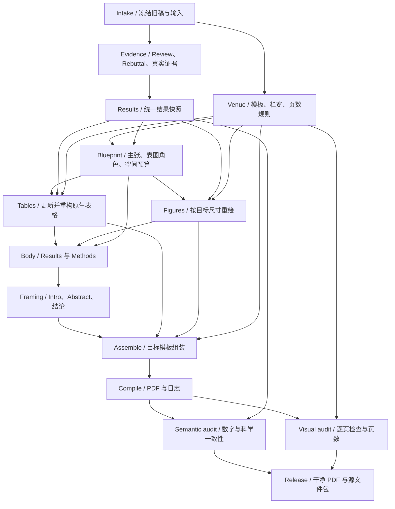

# Resubmit to a Different Conference

**Evidence-led, layout-aware paper resubmission.**

一个面向转投的科研 skill：把 **rebuttal 新证据、原生表格、图的重做、单双栏模板迁移、全文写作、页数控制和最终 PDF 美观** 放进同一条有依赖顺序的流程。

不是只换 `.sty`，也不是只重新写一份 rebuttal。核心是：**证据与模板先确定，表图先稳定，再写全文，最后通过真实编译和逐页视觉检查收敛。**

## 核心能力

| 模块 | 实际职责 |
|---|---|
| 模板与版式 | 核对具体会议、年份、track、阶段；从干净目标模板迁移；测量实际栏宽；保护官方样式文件。 |
| Rebuttal → 表格 | 合并可验证的新结果，保留旧快照；重算排名、增益和强调；同步正文与图，不把缺失当零。 |
| 表格重构 | 分组表头、转置、拆分、单栏/跨栏变体；原生 LaTeX 表格，不默认缩小成不可读内容。 |
| 图的重做 | 定量图从数据重绘，方法图保留可编辑矢量；按最终栏宽改变布局，而非机械缩放。 |
| 全文写作 | 参考 Research Autopilot 的证据优先、主张一致性、结果驱动写作；新稿不依赖旧 rebuttal 才能读懂。 |
| 页数与美观 | 先预算，后编译；检查实际计数范围、字体、裁剪、浮动位置和阅读顺序，不用改页边距等方式挤页数。 |

## DAG：每轮内部无环，反馈进入下一轮



**重要顺序：**模板信息在最前面获取，不能写完后才发现宽度不合适；最终分页在编译后决定，不能用初始字数预算代替。表格和图片在证据与布局方案稳定后可以并行制作。

每轮修订是一张 DAG。数字、模板或主张改变后，开启新版本并标记相关下游产物过期，而不是把反馈箭头塞进 DAG。脚本能计算受影响节点，但不是后台调度器。

## 使用

主入口：[skills/resubmitting-papers/SKILL.md](skills/resubmitting-papers/SKILL.md)。整个目录自包含，包含六份按需读取的专业参考和四个 Python 工具。

在支持 Agent Skills 的本地环境中，将整个 `skills/resubmitting-papers/` 目录安装到该环境的技能目录，不要只复制 `SKILL.md`。例如本地 Codex 可放入项目的 `.agents/skills/`；当前宿主的实际发现路径以官方说明为准。仓库更新不等于已安装到当前 ChatGPT 会话。

示例指令：

> 使用 resubmitting-papers，将这份论文转到指定会议、年份和阶段。联合阅读原稿、reviews、rebuttal 和已完成结果。先核对目标模板，再更新表格和重绘图片，然后按证据改写全文，最后控制页数并逐页检查。保留原始基线，交付干净 PDF、可编译源文件 ZIP，以及单独的修改报告。缺失实验不得补造。

## 工具与测试

```bash
# 查看顺序或结果变化后需要重做的阶段
python skills/resubmitting-papers/scripts/workflow.py
python skills/resubmitting-papers/scripts/workflow.py --changed results

# 从规范数据生成原生表格与来源记录
python skills/resubmitting-papers/scripts/tables.py tests/fixtures/results.json \
  --out build/table.tex --columns 2 --span full

# 核心回归测试：标准库即可
python -m unittest discover -s tests -v

# 版式烟雾测试：需要 latexmk / TeX Live；PyMuPDF 可渲染页面
python tests/build_layout_fixtures.py
```

`qa.py` 提供 PDF 页数、文本边界、小字号、日志问题和视觉验收版本检查；`package.py` 只从明确允许的文件清单制作源文件 ZIP。它们不能自动证明科学正确性或审美质量。详细边界见 [质量与交付](skills/resubmitting-papers/references/quality.md)。

## 验证状态

当前版本通过 **37 项确定性回归测试**。单栏和双栏 `article` 样例均已编译、渲染，并从干净源文件 ZIP 重新编译。样例只含明确标注的合成软件测试数据，**不是官方 ICML/ICLR 模板或真实论文**。未声称完成任意会议模板兼容性、独立 agent 行为评测或录用率验证。

详见 [验证记录](docs/VALIDATION.md)、[设计](docs/DESIGN.md)、[参考与继承](docs/SOURCES.md)。

## 边界

不伪造实验，不用图像生成器绘制定量证据，不修改官方样式文件挤页数，不隐藏负结果，不把表格栅格化。编译成功不等于视觉合格；视觉合格不等于科学结论成立。

此公开仓库只放技能、工具和合成测试。真实论文、review、rebuttal、私有结果、内部审计和身份信息不默认上传。不会自动投稿，也不承诺后台无限运行。

License: MIT. 新编写的流程与工具；参考来源及明确未继承的规则见 `docs/SOURCES.md`。
