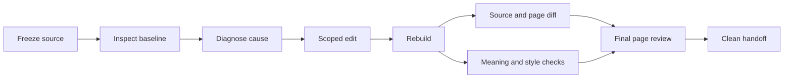

# ReSubmit

### Keep the science. Fix the paper.

**LaTeX-native paper revision for research agents.** From a stubborn caption to a different conference: edit the existing source, preserve the evidence, rebuild, and inspect the PDF you actually deliver.

[](https://github.com/Yunbo-max/Resubmit-to-a-different-conference/actions/workflows/ci.yml)
[](LICENSE)

**v0.2.0** · [Install](docs/INSTALL.md) · [Skill](skills/resubmitting-papers/SKILL.md) · [Project website source](site/) · [Website deployment](docs/WEBSITE.md) · [Validation](docs/VALIDATION_v0.2.0.md)

ReSubmit is the display name. The repository remains `Resubmit-to-a-different-conference`, and the installed skill remains `resubmitting-papers`.

## Start with the edit you need

| Operation | Scope |
|---|---|
| `latex-edit` | Fix spacing, captions, equations, floats, references and local style problems in existing TeX. |
| `layout-only` | Change formatting without rewriting the wording, numbers or mathematical meaning. |
| `rebuttal-update` | Reconcile real new results, then update dependent tables, plots and claims. |
| `retarget` | Verify the exact venue/year/stage; migrate the template and redesign assets for its geometry. |
| `full-revision` | Restructure the full argument only when explicitly authorized. |
| `diagnose` | Inspect and report without editing. |

A caption fix should not trigger an introduction rewrite. A clean build should not be mistaken for a visually correct paper.

## Install

Python 3.10+ is needed for the helper scripts. Your host supplies the agent and its tools.

```bash
git clone https://github.com/Yunbo-max/Resubmit-to-a-different-conference.git
cd Resubmit-to-a-different-conference
python scripts/install_skill.py --agent codex
# Or: python scripts/install_skill.py --agent claude
```

The installer copies the **complete** skill directory. It does not download dependencies, run shell commands, modify your manuscript or overwrite an existing installation. Read [installation and update instructions](docs/INSTALL.md), then open a new agent session and verify discovery. This repository is not automatically installed in a ChatGPT conversation.

Example request:

> Use resubmitting-papers to fix the caption spacing in my existing LaTeX project. Inspect the PDF first, preserve the official template and all unrelated content, make a scoped source edit, rebuild, and report the source diff, affected pages and remaining issues. Do not rewrite the paper.

## The dependency order matters



For a full retarget: **target rules + verified results → style baseline → claim/space blueprint → tables and figures → writing → compile → audits**. Each revision is a DAG; feedback starts a new revision. The graph helper plans dependencies; it is not a scheduler.

## What is included

**Tables:** native LaTeX, explicit missingness and provenance, comparable protocol groups, recomputed best-value emphasis. No rasterized result tables or invented statistics.

**Figures:** measured plots regenerated from data; editable method diagrams reflowed for the target width; final-size inspection inside the paper.

**Style:** distinguish template defaults, package overrides, local setting leaks and page-building behavior. Do not repair page limits by modifying official styles.

**Writing:** evidence-led principles adapted from Research Autopilot. Keep claims consistent across prose, captions, abstract and conclusion.

**Verification:** source snapshots, protected-file checks, rendered page differences, style probes, PDF preflight and allowlisted source packaging. These helpers expose evidence; they do not certify scientific truth or aesthetic quality.

[Native editing](skills/resubmitting-papers/references/latex-edit.md) · [Spacing and style](skills/resubmitting-papers/references/latex-format.md) · [Tables](skills/resubmitting-papers/references/tables.md) · [Figures](skills/resubmitting-papers/references/figures.md) · [Writing](skills/resubmitting-papers/references/writing.md) · [Layout](skills/resubmitting-papers/references/layout.md)

## Reproduce the website demo

```bash
python -m pip install -r requirements-qa.txt -r requirements-demo.txt
# Install latexmk and a TeX distribution with article and booktabs first.
python scripts/build_demo.py
python -m http.server 8000 --directory site --bind 127.0.0.1
```

Open `http://localhost:8000`. The before/after previews are compiled from [the checked-in LaTeX sources](examples/spacing-leak). They demonstrate a scoped font repair using identical words and values. All data are **synthetic software fixtures**, not research results. The page is a project presentation, not an online manuscript editor.

## Test and contribute

```bash
python -m unittest discover -s tests -v
python tests/check_latex_native.py --out build/native-run-1
```

The complete suite runs in CI; PDF tests require PyMuPDF, and compilation fixtures additionally require TeX. Historical records cover 96 tests at v0.1.2; see the [current validation record](docs/VALIDATION_v0.2.0.md) for what was actually rerun in this release. Generic article fixtures do not establish compatibility with every conference author kit or arbitrary agent behavior.

Contributions are welcome: [contribution guide](CONTRIBUTING.md), [security and privacy](SECURITY.md), [changelog](CHANGELOG.md), [roadmap](docs/ROADMAP.md), [citation](CITATION.cff).

## Boundaries and acknowledgments

No fabricated experiments, automatic submissions, acceptance guarantees, hidden negative results or font-file redistribution. Keep private manuscripts and reviews out of this public repository. Host-model privacy and compute policies remain the user's responsibility.

The design draws on the author's [Research Autopilot](https://github.com/Yunbo-max/Research_Autopilot), evidence-led rebuttal workflows and render-first LaTeX QA. See [sources](docs/SOURCES.md) and the [LaTeX skill comparison](docs/LATEX_SKILL_REVIEW.md). This is an engineering integration, not a claim to have invented the underlying practices.

MIT © Yunbo Long.
