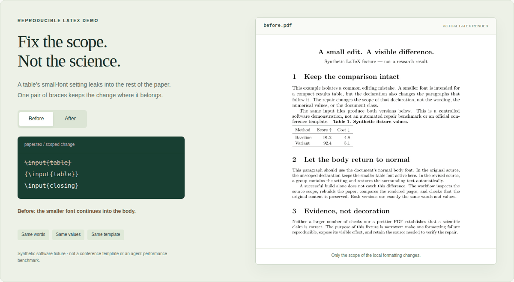
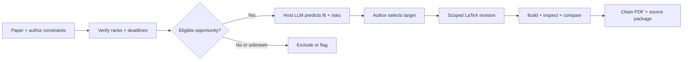

<p align="center">
  <a href="docs/PROJECT_PAGE.md"></a>
</p>

<p align="center">
  <a href="docs/PROJECT_PAGE.md"><strong>Project page</strong></a> ·
  <a href="#see-it-in-action"><strong>Animated demo</strong></a> ·
  <a href="#quick-start"><strong>Quick start</strong></a> ·
  <a href="docs/INSTALL.md">Documentation</a> ·
  <a href="CONTRIBUTING.md">Contribute</a>
</p>

<p align="center">
  <a href="https://github.com/Yunbo-max/Resubmit-to-a-different-conference/actions/workflows/ci.yml"></a>
  <a href="LICENSE"></a>
  <a href="skills/"></a>
  <a href="docs/INSTALL.md"></a>
</p>

**Your paper deserves a better next submission—not another round of formatting hacks.**

ReSubmit gives the agent you already use two focused skills: choose a suitable
conference, then revise the original LaTeX. It brings venue fit, verified deadlines,
reviewer feedback, tables, figures and PDF checks into one evidence-led workflow.

**No model training. No separate prediction API. No manuscript-upload website.**
Your host supplies the LLM and tools; its normal usage costs and privacy policies apply.

## See it in action

<picture>
  <source media="(prefers-reduced-motion: reduce)" srcset="docs/assets/latex-revision-still.png">
  
</picture>

**One pair of braces. The same words, numbers and template.** A table's small-font
setting leaks into the body; a scoped correction keeps it local. These are real
compiled previews of a **Synthetic software fixture**, not generated research
results or a benchmark of autonomous repair.

[Static comparison](docs/SHOWCASE.md#static-comparison) ·
[Reproduce the LaTeX](examples/spacing-leak/) ·
[Inspect how the media is built](scripts/build_readme_media.py)

## Two skills. One submission workflow.

<table>
<tr>
<td width="50%" valign="top">
<h3>01 / Find your next venue</h3>
<p><code>selecting-conference-venues</code></p>
<p>Read the contribution. Check CORE/ICORE and CCF independently. Verify the exact edition, track, paper type and mandatory deadlines. Let your existing LLM recommend a primary and backups—with reasons and revision risks.</p>
<p><a href="skills/selecting-conference-venues/SKILL.md"><strong>Explore venue selection →</strong></a></p>
</td>
<td width="50%" valign="top">
<h3>02 / Fix the actual paper</h3>
<p><code>resubmitting-papers</code></p>
<p>Work directly in LaTeX. Incorporate verified rebuttal updates, restructure native tables, redraw figures for the target width, repair style drift, and compare the compiled pages. A local edit stays local.</p>
<p><a href="skills/resubmitting-papers/SKILL.md"><strong>Explore LaTeX revision →</strong></a></p>
</td>
</tr>
</table>

**Already know the venue?** Go straight to the revision skill. Fixing a caption
never needs a new venue search or a full manuscript rewrite.

## Quick start

Clone, inspect, and install either or both skills:

```bash
git clone https://github.com/Yunbo-max/Resubmit-to-a-different-conference.git
cd Resubmit-to-a-different-conference

python scripts/install_skill.py --agent codex --skill selecting-conference-venues
python scripts/install_skill.py --agent codex --skill resubmitting-papers
```

For **Claude Code**, replace `--agent codex` with `--agent claude`. Other hosts can
use `--destination /path/to/skill-name`. Existing installations are never overwritten.
[Setup, required tools and safe updates →](docs/INSTALL.md)

<details>
<summary><strong>Copy a prompt: recommend a venue</strong></summary>

```text
Use selecting-conference-venues to read my paper and recommend a primary
and two backup conferences. Require CORE A or above and show CCF separately.
Check the next six months, exact tracks and all mandatory submission stages.
Assess contribution fit, evidence readiness, reviewer risks and revision burden.
Cite current official facts and label your forecasts as subjective judgments.
```

</details>

<details>
<summary><strong>Copy a prompt: revise the LaTeX</strong></summary>

```text
Use resubmitting-papers to retarget this LaTeX project to the selected venue,
year and track. Reuse the verified requirements. Incorporate only verified
review/rebuttal updates. Preserve the evidence and official template.
Rebuild, compare changed pages, and deliver a clean PDF and source package.
Do not rewrite unrelated content to fix a local formatting issue.
```

</details>

## The details are the work

| Need | What ReSubmit is designed to do |
| :--- | :--- |
| **A realistic submission plan** | Separate official eligibility from model-predicted fit; explain primary, backup, conditional and excluded options. |
| **Rebuttal updates that stay consistent** | Trace changed values into tables, rankings, plots, captions and numerical claims. Missing results stay missing. |
| **Tables and figures that actually fit** | Restructure native tables; redraw verified-data plots and editable diagrams for the target column width. |
| **LaTeX without accumulated hacks** | Diagnose template overrides, package conflicts, scope leakage, float queues and page-building effects before patching. |
| **A paper you can inspect** | Protect official styles, track source changes, compare rendered pages and package only allowed files. |

<details>
<summary><strong>See the decision-to-revision workflow</strong></summary>



Selection is optional when the target is known. Each revision has an acyclic
workflow; changes reopen only the affected downstream checks.
[Local-edit DAG](skills/resubmitting-papers/assets/latex-edit-workflow.json) ·
[Full retargeting DAG](skills/resubmitting-papers/assets/workflow.json)

</details>

## Evidence before promises

Venue forecasts are **subjective host-model judgments**, not calibrated acceptance
probabilities. The skill never invents current deadlines, treats a high fit score
as permission to ignore eligibility, or guarantees acceptance.

The repository includes deterministic tests, reproducible LaTeX fixtures and
inspectable source. Those checks do **not** establish recommendation accuracy,
scientific correctness or universal conference-template compatibility.

[Actual CI](https://github.com/Yunbo-max/Resubmit-to-a-different-conference/actions/workflows/ci.yml) ·
[Functional validation](docs/VALIDATION_v0.3.0.md) ·
[Visual assets and provenance](docs/SHOWCASE.md) ·
[Project-page preview](docs/PROJECT_PAGE.md)

## Open development

[Contributing](CONTRIBUTING.md) · [Report a bug](https://github.com/Yunbo-max/Resubmit-to-a-different-conference/issues/new/choose) ·
[Roadmap](docs/ROADMAP.md) · [Changelog](CHANGELOG.md) · [Citation](CITATION.cff) · [Launch copy](docs/LAUNCH.md)

Keep unpublished manuscripts, confidential reviews, private results and credentials
out of public issues. The skills do not automatically submit papers, publish
artifacts, run experiments or buy compute. See [Security](SECURITY.md).

<p align="center"><sub>Built by <a href="https://github.com/Yunbo-max">Yunbo Long</a> · MIT licensed · <a href="docs/SOURCES.md">Upstream acknowledgments</a><br>For the work between submissions.</sub></p>
