<p align="center">
  <picture>
    <source media="(prefers-reduced-motion: reduce)" srcset="docs/assets/intro-manga-still.svg">
    
  </picture>
</p>

<p align="center"><strong>From your current manuscript to its next submission — with the agent you already use.</strong></p>

<p align="center">
  <a href="#quick-start"><strong>Get Started</strong></a> ·
  <a href="#example-result"><strong>Example Outputs</strong></a> ·
  <a href="#workflow-in-motion">Workflow</a> ·
  <a href="#how-resubmit-compares">Comparison</a> ·
  <a href="docs/INSTALL.md">Documentation</a>
</p>

# Find the Right Venue. Revise the Paper.

**One paper. Two Agent Skills. A connected workflow from conference recommendation and reviewer feedback to an updated LaTeX manuscript and inspected PDF.**

<p align="center"><sub>Works with your existing Codex or Claude Code agent · MIT licensed · No separate prediction model to install</sub></p>

<a id="quick-start"></a>
## 🚀 Get Started — Install ReSubmit in Your Agent

Install the two skills into Codex:

```bash
git clone https://github.com/Yunbo-max/Resubmit.git
cd Resubmit

python scripts/install_skill.py --agent codex --skill selecting-conference-venues
python scripts/install_skill.py --agent codex --skill resubmitting-papers
```

**Claude Code:** replace `--agent codex` with `--agent claude`. You can install either skill separately. Existing installations are not silently overwritten. [Installation and update guide](docs/INSTALL.md).

## What goes in → what comes out

| **What you provide** | **What you receive** |
|:--|:--|
| **Your paper:** `main.tex`, bibliography, figures, tables or an existing PDF | **Venue shortlist:** paper-specific primary and backup venues, exact target tracks, sourced CORE/CCF information and deadlines |
| **Your reviews:** reviewer comments, rebuttal and any verified new results | **Revision plan:** reviewer concern → evidence gap → proposed changes to specific sections, tables or figures |
| **Your preferences:** target tier, time window, preferred field and available revision effort | **Revised LaTeX and PDF:** updated source, tables and figures, target-template adaptation, compile/layout checks and source package when the host has the necessary tools |

**Two independent skills:** already picked a venue? Start directly with LaTeX revision. Need only venue recommendations? Run the selection skill without changing any manuscript files.

## Try It — One Prompt, Three Deliverables

### Copy this prompt

```text
Read my manuscript, available experimental results and previous reviews.

1. Identify my research contribution and its best-fit community.
2. Recommend one primary and two backup conferences. Check current
   official CFPs, CORE/CCF rankings, relevant tracks and deadlines.
3. Explain the major reviewer concerns and identify what existing
   evidence answers them versus what remains unverified.
4. Propose a concrete revision plan for the venue I select.
5. After I approve, update my original LaTeX, tables and figures;
   compile and inspect the resulting paper if the tools are available.

Show the venue choices, reviewer-to-revision map and final file status.
```

<a id="example-result"></a>
### Example result — what your agent can return

*Hypothetical example: a long-context attention paper receives reviewer concerns about compute fairness. Venue names and deadlines are placeholders, not live recommendations; no experimental result is invented.*

```text
01  VENUE SHORTLIST
    Primary   [Venue A / edition / main track]
              Strong topic fit; compute-matched results still needed
    Backup A  [Venue B / edition / track]
              Better scope fit for efficient sequence modeling
    Backup B  [Venue C / edition / track]
              May require stronger systems measurements
    CORE / CCF / deadlines: [official sources + verification status]

02  REVIEW → REVISION PLAN
    R1  "Could the gains come from extra compute?"
        → Find or run an authorized matched-FLOPs comparison
        → Update Table 2 + the Results interpretation
    R2  "Efficiency claims lack latency measurements."
        → Verify available measured runtime and memory
        → Add Figure 3 or narrow the efficiency claim
    Unrun experiments stay marked PENDING.

03  REVISED PAPER (after you approve the target)
    main.tex       revised Methods, Results and citations
    tables/*.tex   source-backed baseline comparisons
    figures/*      target-width, editable/reproducible visuals
    paper.pdf      compile + page-by-page checks, when available
    source.zip     clean manuscript source package
    Status         [completed / blocked / needs author review]
```

**[Conference recommendation template](skills/selecting-conference-venues/assets/report-template.md)** · **[Review-to-LaTeX revision template](skills/resubmitting-papers/assets/revision-plan-template.md)**

<a id="workflow-in-motion"></a>
## How ReSubmit works — in motion

The **first illustration introduces the project**. The second is its **actual workflow diagram** (a six-stage, directed process), not another before/after paper illustration.

<picture>
  <source media="(prefers-reduced-motion: reduce)" srcset="docs/assets/workflow-manga-still.svg">
  
</picture>

**One end-to-end handoff, not six disconnected prompts.** Follow the numbered arrows from the manuscript and previous reviews through the venue choice and LaTeX/PDF checks. The animation highlights each stage in sequence. It is a *schematic illustration of the documented skill workflow*, not a live agent recording, official conference calendar or acceptance-rate prediction.

<details>
<summary><strong>What happens at each stage?</strong></summary>

1. **Read:** Recover the manuscript, contribution, verified results, previous author-visible reviewer concerns and constraints.
2. **Route by discipline:** Identify the *scientific* audience and evidence standards. An AI method and an AI-for-chemistry application may need different reviewers and proof. Optionally consult a pre-installed specialist skill such as [K-Dense Scientific Agent Skills](https://github.com/K-Dense-AI/scientific-agent-skills); no extra dependency is required.
3. **Verify eligibility:** Check current official CORE/ICORE, CCF and CFP information for the exact venue, year, track, paper type, deadlines and registration prerequisites. Never invent dates.
4. **Recommend:** The host LLM judges venue fit, evidence maturity, likely reviewer objections, submission timing and required revision effort. Return primary/backup choices and uncertainty, **not calibrated acceptance probabilities**.
5. **Revise:** After author approval, reconcile rebuttal updates with experimental sources, change native tables and plots, adapt official LaTeX templates and improve evidence-grounded writing.
6. **Audit:** Compile, compare rendered pages, verify counted length and style, then prepare a clean PDF/source ZIP for the author's final review.

Venue selection is optional if the target is already known. A local format fix need not rerun the full pipeline. Both illustrations have reduced-motion alternatives; if a GitHub client does not animate SVG, the full flow remains visible.

[Design and accessibility notes](docs/VISUAL_DESIGN.md).

</details>

## How ReSubmit compares

These open-source projects provide important pieces. Among the repositories inspected for this comparison, **ReSubmit explicitly connects venue eligibility and paper-fit decisions to manuscript revisions and final-PDF QA**. This is an integration focus, not proof that other agents cannot reproduce the pipeline.

| Documented workflow | **ReSubmit** | [CCFDDL](https://github.com/ccfddl/ccf-deadlines) | [K-Dense](https://github.com/K-Dense-AI/scientific-agent-skills) | [Venue targeting](https://github.com/lengmo1996/VibeResearch-skills) | [Rebuttal-Skill](https://github.com/TobiasLee/Rebuttal-Skill) | [Paper revision](https://github.com/lachlanchen/paper-revision-skill) |
|:--|:--:|:--:|:--:|:--:|:--:|:--:|
| CORE/CCF and deadline verification | ✓ | ✓ | — | ◐ | — | — |
| Discipline-specific scientific procedures | ◐ | — | ✓ | ◐ | ◐ | ◐ |
| Paper-specific primary / backup venue | ✓ | — | — | ✓ | ◐ | — |
| Reviewer concerns → revision plan | ✓ | — | ◐ | ◐ | ✓ | ✓ |
| Native LaTeX layout, tables and figures | ✓ | — | ◐ | — | — | ✓ |
| Compiled PDF and layout checks | ✓ | — | ◐ | — | — | ✓ |
| **Venue choice → revision → PDF handoff** | **✓** | — | ◐ | ◐ | ◐ | ◐ |

**Legend:** ✓ documented workflow; ◐ related or partial capability; — not the project's primary documented workflow. **This is a scope comparison, not a head-to-head benchmark.** In particular, K-Dense supplies substantially richer discipline-specific research procedures than ReSubmit. For full source links and caveats see [comparison methodology](docs/FEATURE_MATRIX.md), also including [Orchestra ML Paper Writing](https://github.com/Orchestra-Research/AI-Research-SKILLs/tree/main/20-ml-paper-writing/ml-paper-writing).

## Two skills, designed to work independently

| Need | Skill | Result |
|---|---|---|
| **Which venue next?** | [selecting-conference-venues](skills/selecting-conference-venues/SKILL.md) | Actual constraints, field-aware fit judgments, primary and backups, explicit revision handoff |
| **Improve or retarget a paper** | [resubmitting-papers](skills/resubmitting-papers/SKILL.md) | Source-preserving LaTeX edits, review-linked table and figure revisions, template adaptation, rendered-PDF checks |

[Field-aware routing](skills/selecting-conference-venues/references/discipline-routing.md) is optional guidance for interdisciplinary papers. It is not a trained scientific classifier.

<details>
<summary><strong>Additional example: layout retargeting (schematic)</strong></summary>

The following *illustrations*, not official compiled templates, show a two-column source and one-column target. Actual venue templates must always be verified for the specified year/track.


</details>

## Research-grade templates

Inspired by domain-aware scientific workflows and controlled manuscript revision,
both installable skills now include concise **private working templates** instead
of requiring the agent to invent its own record format each time.

| Task | Reusable template | Records |
|---|---|---|
| **Compare venues for one paper** | [Conference recommendation report](skills/selecting-conference-venues/assets/report-template.md) | Discipline/claim profile, official CORE/CCF/CFP sources, eligibility, subjective fit, primary/backups, missing evidence and author-approved handoff |
| **Revise a rejected or retargeted paper** | [Review-to-LaTeX revision plan](skills/resubmitting-papers/assets/revision-plan-template.md) | Concern IDs, rebuttal promises versus verified data, editable tables/figures, allowed source changes, scientific and PDF validation |

The templates borrow **practical workflow principles**, not copied code, from
[K-Dense's multidisciplinary science skills](https://github.com/K-Dense-AI/scientific-agent-skills)
and focused rebuttal/revision tools. [See what was adapted, credited and deliberately left out](docs/UPSTREAM_ADAPTATIONS.md).
K-Dense and other specialist skills are optional; install neither to use ReSubmit.
A small LaTeX formatting fix still follows the short path.

## Open development

[Validation](docs/VALIDATION_v0.3.0.md) · [Contribute](CONTRIBUTING.md) · [Report an issue](https://github.com/Yunbo-max/Resubmit/issues/new/choose) · [Roadmap](docs/ROADMAP.md) · [Changelog](CHANGELOG.md) · [Citation](CITATION.cff)

<p align="center"><sub>Built by <a href="https://github.com/Yunbo-max">Yunbo Long</a> · MIT Licensed · For the work between submissions.</sub></p>
