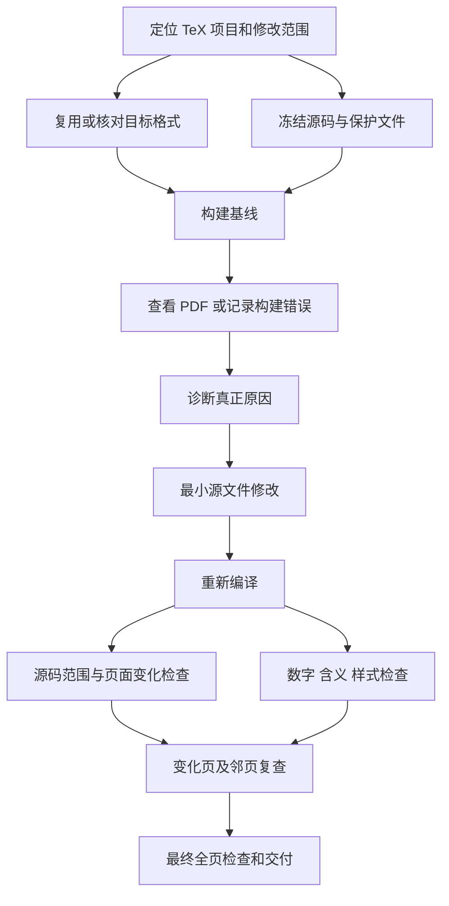

# Resubmit to a Different Conference

**LaTeX-native revision, evidence-led resubmission.**

主要用于修改已有 AI 会议论文的 LaTeX 源码：间距、字号、caption、公式、算法、表格、图片、引用、页数和单双栏模板迁移。保留 Research Autopilot 的写作与证据约束，但不让每一次局部排版修复变成整篇重写。

**当前版本：v0.1.2。** [技能入口](skills/resubmitting-papers/SKILL.md) · [融合说明](docs/LATEX_NATIVE.md) · [本版验证](docs/VALIDATION_v0.1.2.md)

## 默认是 LaTeX 修改，不是全文生成

| 任务 | 处理范围 |
|---|---|
| 修间距、标题、caption、字体、公式换行、浮动和引用 | `latex-edit`：直接修改现有源文件，先看 PDF，定位原因，最小修复 |
| 只改格式 | `layout-only`：不改原文、数字和数学含义 |
| 补入 rebuttal 的真实结果 | `rebuttal-update`：核对证据，再同步表格、图和受影响结论 |
| ICML/ICLR/其他会议之间转投 | `retarget`：核对具体年份和阶段，迁移模板与表图布局 |
| 改整篇论证和结构 | `full-revision`：仅在明确授权时进行 |
| 只检查 | `diagnose`：不编辑源码 |

## 局部修改 DAG



每轮内部无环；修改反馈进入下一轮。旧 PDF 无法构建时，可以从真实日志诊断，但不能伪称完成前后图像比较。最终候选仍须实际编译和检查。

整篇转投仍保留原来的 [完整 DAG](skills/resubmitting-papers/assets/workflow.json)：模板与证据 → 样式基线 → 表图与空间设计 → 写作与组装 → 编译及三类审计 → 交付。默认局部路径不强制触发这张完整图。

## 融合后的模块

[原生 LaTeX 修改](skills/resubmitting-papers/references/latex-edit.md)负责实际执行顺序；[间距与样式](skills/resubmitting-papers/references/latex-format.md)负责格式归属、宏包、作用域和运行时探针；[表格](skills/resubmitting-papers/references/tables.md)、[图片](skills/resubmitting-papers/references/figures.md)、[写作](skills/resubmitting-papers/references/writing.md)、[版式](skills/resubmitting-papers/references/layout.md)和[交付](skills/resubmitting-papers/references/quality.md)按需读取。

重点参考 `paper-compile-layout-qa` 的“精确模板、先看渲染、修拥有该设置的层、比较受影响页面”。没有复制上游代码、要求外部插件常驻，或照搬全局间距/字体重置。来源与边界见 [融合说明](docs/LATEX_NATIVE.md) 和 [既有来源记录](docs/SOURCES.md)。

## 工具

```bash
# 局部修改顺序（不运行后台任务）
python skills/resubmitting-papers/scripts/workflow.py --operation latex-edit

# 整篇转投仍兼容原来的调用
python skills/resubmitting-papers/scripts/workflow.py --changed results

# 原有 + 新增回归测试
python -m unittest discover -s tests -v

# 单栏/双栏实际 LaTeX 修改测试；每次使用新的输出目录
python tests/check_latex_native.py --out build/native-run-1
```

新增 `revision_check.py` 为显式源码清单建立哈希快照，报告越界修改与保护文件变化；`pdf_revision_diff.py` 按同一 DPI 比较全部物理页面，记录页面增加、删除、尺寸与像素变化。两者都不自动编辑论文，也不认证科学正确性或美观。

原有 `tables.py`、`latex_format.py`、`qa.py`、`package.py` 继续负责原生表格、样式诊断、PDF 预检和允许清单打包。编译器仍由宿主提供，优先使用经过检查的项目构建方式。纯 Python 检查主要依赖标准库；PDF 比较需要 PyMuPDF。

## 使用方式

安装完整 `skills/resubmitting-papers/` 目录到宿主支持的 Agent Skills 目录，不要只复制 `SKILL.md`。仓库更新不等于已安装到当前会话。

> 使用 resubmitting-papers，直接修改现有 LaTeX。先检查目标位置的 PDF 和源码，保留官方模板及未授权内容；完成最小修改后重新编译，报告源码差异、变化页面和剩余问题。不要为了一个 caption 或间距问题重写全文。

## 验证与限制

v0.1.2：**96 项测试通过**（原有 69 项 + 新增 27 项）。实际编译了单栏和双栏的修改前/后样例，检查局部作用域修复、正文样式恢复、越界改动检测和页面变化。详见 [验证记录](docs/VALIDATION_v0.1.2.md)。

测试只使用明确标注的合成 `article` 样例，不是官方会议模板覆盖或真实论文效果评测。修复样例中的字号泄漏不证明任意格式问题都能自动解决。源码清单可能不完整；像素相同不代表语义、链接和元数据相同。最后仍需科学、格式、匿名性和全页视觉验收。

不伪造实验，不用生成图像绘制定量证据，不修改官方样式挤页数，不公开真实论文/reviews/rebuttal，不自动投稿。MIT License。
