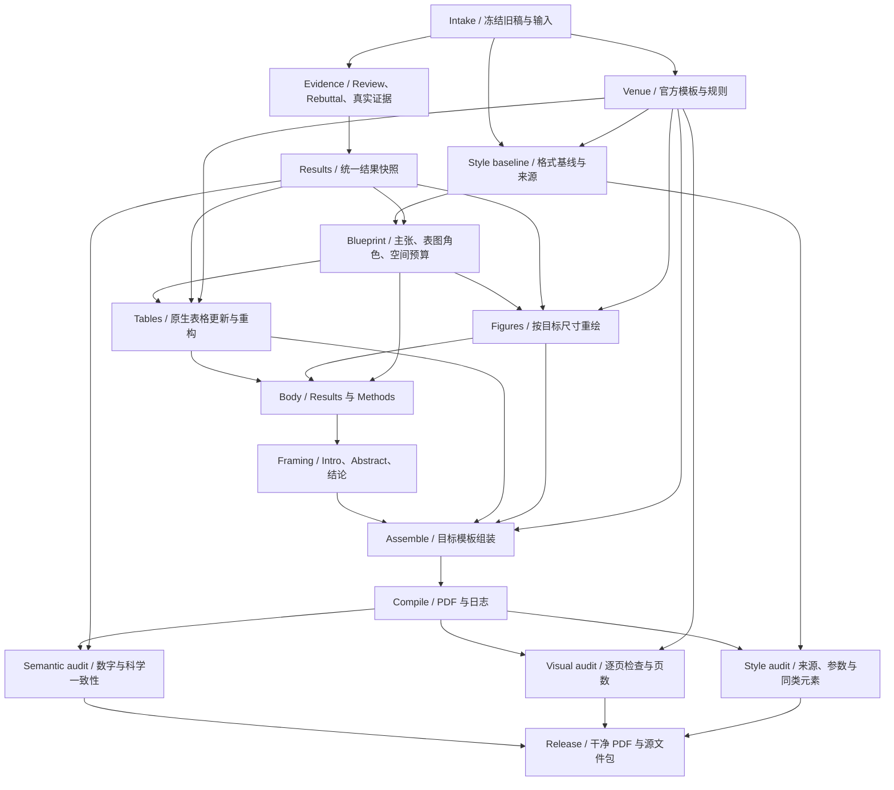

# Resubmit to a Different Conference

**Evidence-led, layout-aware paper resubmission.**

把 rebuttal 新证据、原生表格、图的重做、单双栏模板迁移、全文写作、LaTeX 间距与样式、页数控制和最终 PDF 检查，放进同一条有依赖顺序的流程。

不是只换 `.sty`：**证据与目标格式先确定，表图先稳定，再写全文，最后通过实际编译和逐页检查收敛。**

## v0.1.1：新增 LaTeX 间距与样式诊断

在调页数之前，先区分官方模板默认、旧 preamble 残留、宏包覆盖、局部字体/间距声明、页面伸缩胶和图片内部留白。不是把所有间隔改成一个数字。

新增 [latex-format.md](skills/resubmitting-papers/references/latex-format.md)、只读扫描/日志比较工具 `latex_format.py` 和实际参数探针。参考了 Orchestra 的 `ml-paper-writing`、`paper-compile-layout-qa`、flonat 的 `latex-template`/`latex-polish`，但没有导入其通用 working-paper 样式、固定间距或运行依赖。

[源码比较与本次验证](docs/LATEX_SKILL_REVIEW.md)。当前 **69 项确定性测试通过**，另完成单/双栏共六个参数探针编译样例。不是官方会议模板兼容性或审美效果证明。

## 核心能力

| 模块 | 职责 |
|---|---|
| 模板与样式基线 | 核对具体年份、track、阶段；编译干净官方模板；保护样式文件；检查作者层覆盖。 |
| Rebuttal → 表格 | 核对真实来源、保留旧快照；更新可比数据、排名、增益、强调及关联正文。 |
| 原生表格重构 | 分组、转置、拆分、单栏/跨栏变体；不靠不可读缩放或删负结果解决宽度。 |
| 图的重做 | 数据驱动的定量图、可编辑的方法图、真实样例的定性图；按最终尺寸重排。 |
| 全文写作 | 参考 Research Autopilot 的证据优先、主张一致性和结果驱动写作。 |
| 页数与美观 | 先预算后实测；按实际计数规则检查；修复字体、间隔、裁剪和浮动问题。 |

## DAG：每轮内部无环，反馈进入下一轮



机器可读图在 [workflow.json](skills/resubmitting-papers/assets/workflow.json)。变化后开启新版本，并标记下游产物过期；脚本只规划依赖，不执行后台任务。模板信息和样式基线在前，最终分页在编译后；独立表图可并行设计。

## 使用

主入口：[skills/resubmitting-papers/SKILL.md](skills/resubmitting-papers/SKILL.md)。整个目录自包含：七份按需读取的专业参考、五个 Python 工具。将整个目录安装到宿主支持的 Agent Skills 路径，不要只复制入口文件。仓库更新不等于已安装到当前 ChatGPT 会话。

> 使用 resubmitting-papers，联合原稿、reviews、rebuttal 和真实结果，转到指定会议、年份和阶段。先验证模板和样式基线，再更新表格、重绘图片和修改全文，最后检查数字、间距、样式、页数与逐页视觉质量。保留基线，交付干净 PDF、可编译源文件 ZIP 和单独修改报告。缺失实验不得补造。

```bash
python skills/resubmitting-papers/scripts/workflow.py
python skills/resubmitting-papers/scripts/workflow.py --changed style_baseline
python skills/resubmitting-papers/scripts/tables.py tests/fixtures/results.json \
  --out build/table.tex --columns 2 --span full
python skills/resubmitting-papers/scripts/latex_format.py scan /path/to/paper \
  --files main.tex sections/results.tex author-macros.sty --out /tmp/source-style.json
python -m unittest discover -s tests -v
# Optional: requires an installed TeX toolchain
python tests/check_style_probe.py
python tests/build_layout_fixtures.py
```

`latex_format.py` 的命令命中只表示待检查；参数相同也不代表视觉或格式合规。`qa.py` 提供部分 PDF/日志检查与当前 PDF 的视觉验收记录检查；`package.py` 从明确文件清单打包，不打包整个工作区。详见 [质量与交付](skills/resubmitting-papers/references/quality.md)。

## 验证与边界

v0.1.1 的实际测试见 [本次记录](docs/LATEX_SKILL_REVIEW.md)；v0.1.0 的单/双栏表格样例、源文件 ZIP 重编译与37项测试记录保留在 [历史验证](docs/VALIDATION.md)。所有样例都是合成软件测试，不是官方 ICML/ICLR 模板或真实论文。没有进行第三方 skills 的效果对照或独立 agent 行为评测。

不伪造实验，不用图像生成器绘制定量证据，不修改官方样式挤页数，不隐藏负结果，不栅格化表格。编译、样式、视觉和科学有效性不能相互替代。

公开仓库只放技能、工具和合成测试。真实论文、review、rebuttal、私有结果、内部审计和身份信息不默认上传；不分发字体文件，不自动投稿，不承诺后台无限运行。

[初版设计](docs/DESIGN.md) · [初版来源](docs/SOURCES.md) · [LaTeX 来源与适配](skills/resubmitting-papers/references/latex-format.md)

License: MIT. 新编写的流程与工具；参考已有实践，不宣称单项做法原创。
