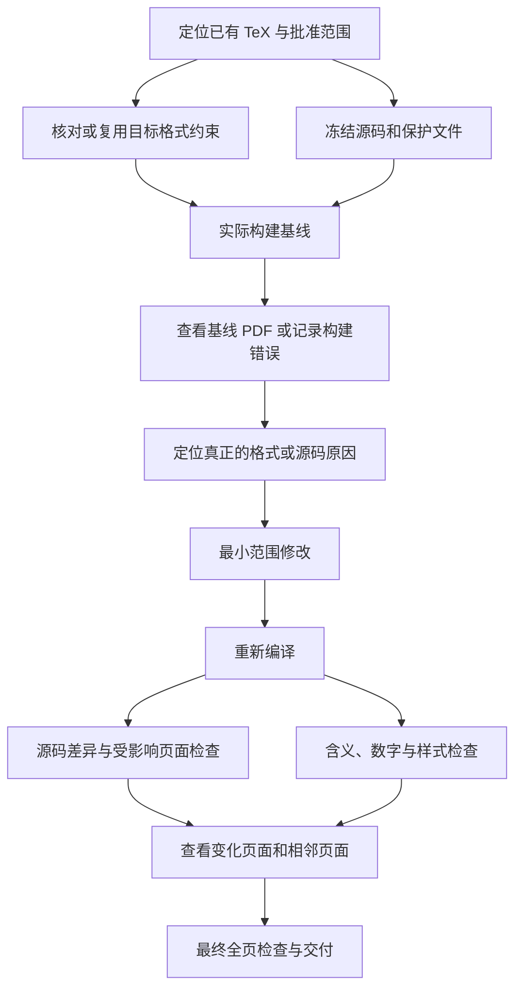

# v0.1.2：把 LaTeX 修改变成默认流程

## 这次融合改变了什么

v0.1.1 已有格式扫描和运行时样式探针，但主入口仍然让人容易沿着整篇转投流程执行。v0.1.2 默认从既有 `.tex` 项目开始，区分局部修改、纯排版、rebuttal 结果更新、换模板和全文重写。前两者不再强制进入研究、表图全部重做或 introduction/abstract 重写。

主入口保留 `resubmitting-papers`，不用安装新的外部插件。新增 `references/latex-edit.md`、局部 DAG、源码范围检查和编译前后 PDF 对比；复用原来的表格、图、写作、格式和最终质量模块。

## 默认顺序

这是每轮的 DAG。没有可编译的旧 PDF 时，可以根据真实日志修复错误，但不宣称做过图像对照。最终候选必须真正编译和检查。

## 从外部方案继承什么

主要参考 `bystander563/paper-compile-layout-qa` 的 exact-kit、render-first、owning-layer fix、changed-page footprint；仍用 Research Autopilot 的证据约束和全文写作原则。没有复制第三方源码、下载其脚本或要求其插件在线。没有实现或假冒上游 `conference_format_audit.py` 的接口兼容性。

不继承通用文档里的全局标题/段距重置、固定间距常数、八页最终抽查上限，也不把截图差异自动当成缺陷。

## 实现边界

`revision_check.py` 对显式监控文件作 SHA-256 快照，发现越界修改及受保护文件变化。它不能自动发现所有输入，也不能证明同一个文件内部的修改在指定段落以内。必须再检查源码 diff、输入清单和新建文件。

`pdf_revision_diff.py` 使用相同 PyMuPDF 渲染器和 DPI 比较所有物理页面，记录增加、删除、尺寸或像素变化，并列出候选相邻页。它不进行语义页匹配，不评判美观，不认证元数据和链接。最终仍需逐页检查。

现有 TeX 编译器仍由宿主提供，默认保留项目实际引擎与构建方法。技能本身不会安装环境、后台运行或自动投稿。

## 来源

- https://github.com/bystander563/paper-compile-layout-qa/blob/main/SKILL.md
- https://github.com/bystander563/paper-compile-layout-qa/blob/main/references/latex-spacing-playbook.md
- https://github.com/Yunbo-max/Research_Autopilot/tree/main/skills/writing-top-tier-papers
- https://ctan.org/pkg/latexmk
- https://pymupdf.readthedocs.io/en/latest/page.html#Page.get_pixmap

本次是工程整合，不宣称这些排版实践或差异检查是学术首创。
