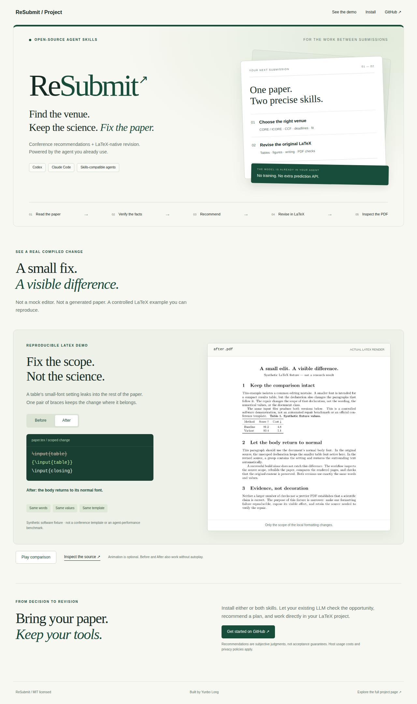
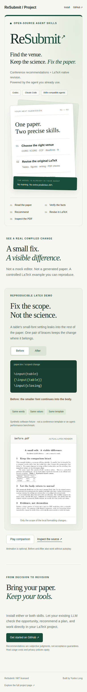

# ReSubmit · Project page

**Find the venue. Keep the science. Fix the paper.**

[Repository](../README.md) · [Install](INSTALL.md) · [Animated demo](../README.md#see-it-in-action) · [Contribute](../CONTRIBUTING.md)

## The project, at a glance

Two open-source Agent Skills for the LLM you already use. One recommends a
submission plan from current facts and your paper; the other revises the original
LaTeX while preserving its evidence and official template.

| Select | Revise |
| --- | --- |
| Independent CORE/ICORE and CCF checks | Scoped native LaTeX edits |
| Exact editions, tracks and mandatory dates | Rebuttal-linked tables and figures |
| Subjective fit and readiness judgments | Template migration, page and style checks |
| Primary, backups, exclusions and reasons | Compiled PDF review and source handoff |

## Desktop preview

This is a rendered preview of the checked-in [project showcase](../site/press.html).
It is a static screenshot, not an online manuscript editor or predictor.

<strong>Mobile preview — 390 px</strong>

## Website source and deployment

The [full project website](../site/index.html) and [visual showcase](../site/press.html)
are static HTML/CSS/JavaScript. No upload, prediction backend, hosted font or remote
script is required. The showcase has explicit Play/Pause, manual Before/After
controls and reduced-motion support.

**This GitHub-rendered page is available now. A screenshot is not proof that the
standalone GitHub Pages site is live.** The repository's Pages configuration and
successful deployment must be checked separately before advertising its public URL.
See [website setup](WEBSITE.md).

The original website remains intact. No unrelated personal-homepage files were changed.

[Start with the skills →](INSTALL.md)
