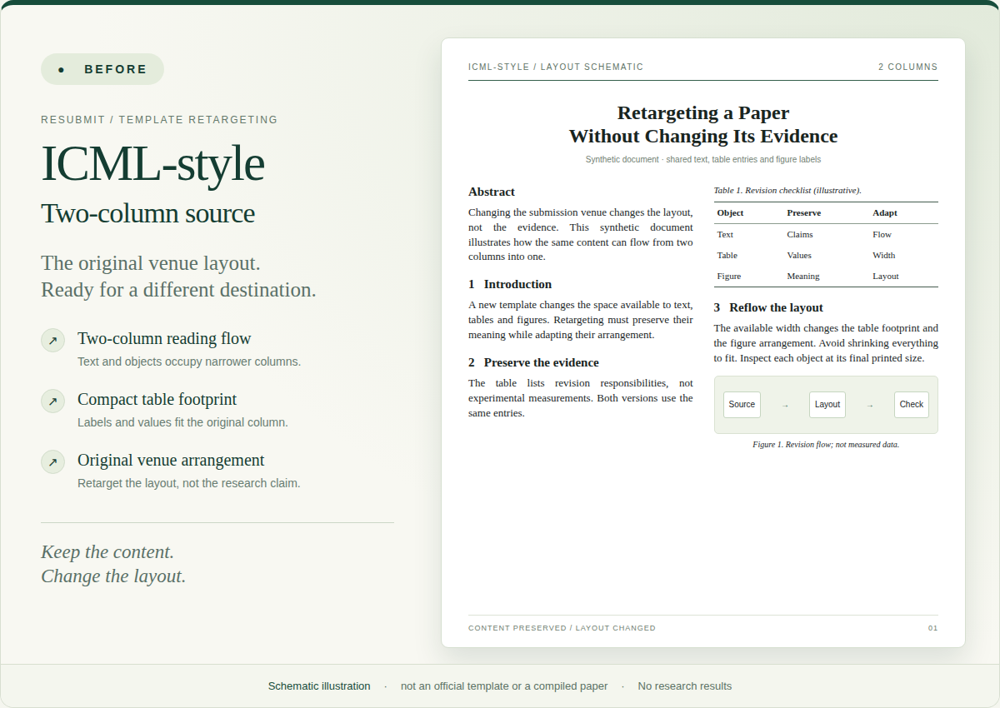
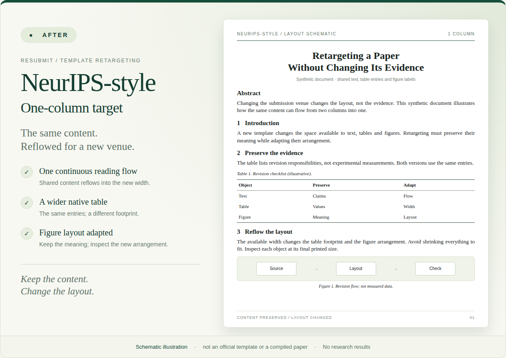

# Template-retargeting illustration

The README shows an **ICML-style two-column** source and a **NeurIPS-style
one-column** target. This replaces the former font-scope example in the main
showcase because that example did not show a change of conference layout.

Both new frames are rebuilt from the **same HTML paper content**, with different
column counts and object widths. The text, table entries and figure labels are
identical. The table is an illustrative checklist; there are no invented
experimental measurements, authors, submission dates or acceptance claims.

These are **schematic illustrations**, not authentic official-template output,
not an actual LaTeX conversion, and not an agent benchmark. The names indicate
the intended two-column-to-one-column comparison, not compliance certification.
Always use the exact venue/year/track author kit for a real submission.

## Static comparison

### Before: ICML-style two-column source



### After: NeurIPS-style one-column target



The GIF `assets/icml-to-neurips.gif` holds each frame for 3.5 seconds. The README
also includes a static comparison and a reduced-motion fallback. It is not a
recording of a live agent. `assets/retargeting-illustration-manifest.json` records
source and image hashes, the shared-content check and the GIF frame checks.

## Rebuild

```bash
python -m pip install -r requirements-showcase.txt
python -m playwright install chromium
python scripts/build_retargeting_media.py
```

An existing Chromium binary may be selected with `--browser /path/to/chromium`.
The renderer reads local source and blocks external page requests. It checks the
paper text, page bounds and GIF timing. No font files are distributed.

The original `examples/spacing-leak/` remains a separate reproducible local-format
example. Its older generator uses different asset names and cannot replace the
new README images. The early AI-generated concept pictures are not advertised as
compiled evidence or used for the new shared-content comparison.

The README no longer links to the unpublished Project page or preview page.
Only in-page navigation and existing repository documentation are linked.
