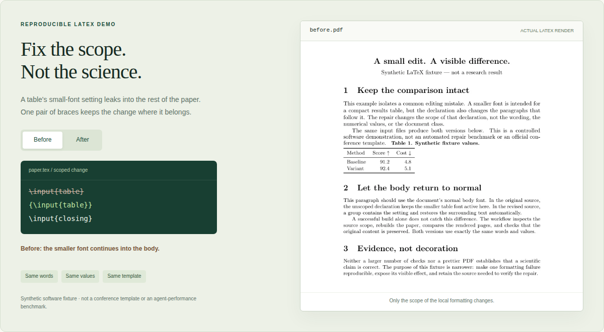
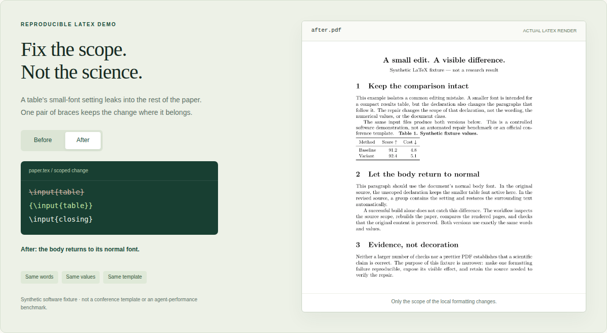

# README visuals and reproducibility

The public README uses a compact editorial cover, native GitHub navigation and
badges, an animated LaTeX comparison, and collapsible instructions. All embedded
showcase files live in `docs/assets/`, so their content does not depend on an image
host or an expiring chat attachment. Status badges link to actual CI or metadata.

## Static comparison

The GIF alternates the following actual rendered states, holding each for 2.8
seconds. There are no invented intermediate paper states. Reduced-motion clients
are offered the still image; this page also makes both states available separately.

### Before — font scope leaks into the body



### After — the local declaration stays local



Both images come from the explicit synthetic fixture in
[`examples/spacing-leak`](../examples/spacing-leak/). The branding cover is a rendered
HTML illustration, not experimental evidence. No generated conference dates,
rankings or acceptance probabilities are embedded in the artwork.

## Rebuild the assets

In a complete checkout, with a working LaTeX toolchain:

```bash
python -m pip install -r requirements-qa.txt -r requirements-demo.txt -r requirements-showcase.txt
python -m playwright install chromium
python scripts/build_demo.py
python scripts/build_readme_media.py
python -m unittest discover -s tests -v
```

`--browser /path/to/chromium` may select an already installed browser. No new
package is needed merely to install either skill. The builder renders a faithful
in-memory copy of the local HTML, CSS, JavaScript and compiled previews; it makes no
network or model calls. It checks desktop/mobile overflow, image loading, mode
buttons, Play/Pause and reduced-motion behavior. This is not an online-endpoint test.

[`media-manifest.json`](assets/media-manifest.json) records source and generated
asset hashes, real demo PDF provenance and the checks from the latest asset build.
The presentation workflow runs the full repository tests before producing files.
The generated screenshots were inspected during development. Rebuilt output must
still be inspected when content or toolchains materially change.

## Publishing boundaries

The dedicated `Build README media` workflow may publish **only its enumerated
presentation files**, and only to the maintainer's `design/readme-showcase` branch.
It never pushes to `main`, runs on untrusted pull requests or force-pushes. The
maintainer reviews and advances `main` separately. Manual runs on other branches
produce an artifact without writing to the branch.

These are presentation and software checks. They do not measure autonomous agent
compliance, venue-recommendation quality, acceptance uplift or arbitrary conference
style compatibility. The functional skill release remains v0.3.0.
